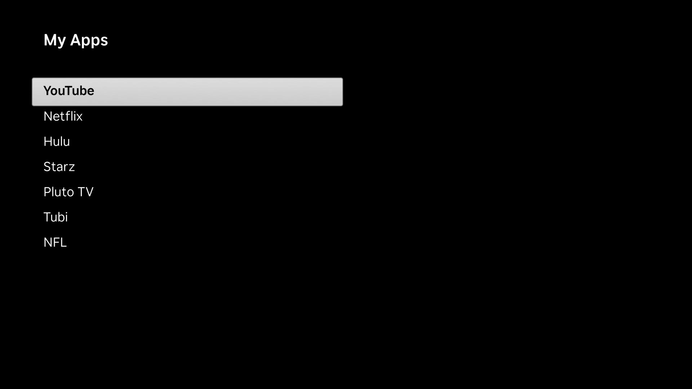
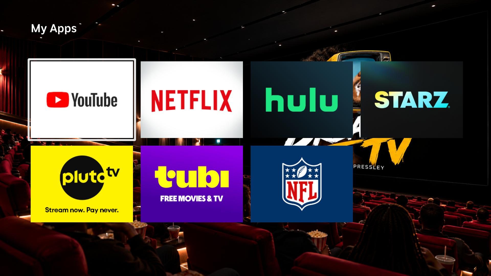
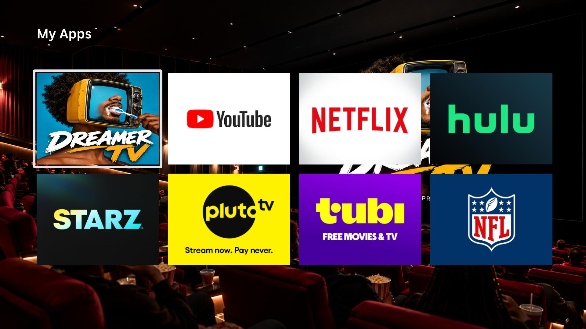
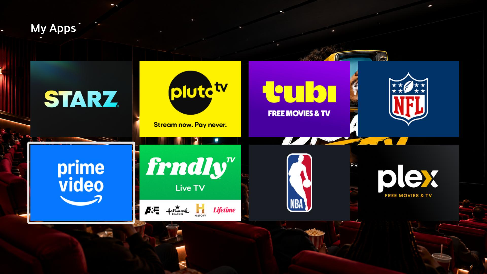
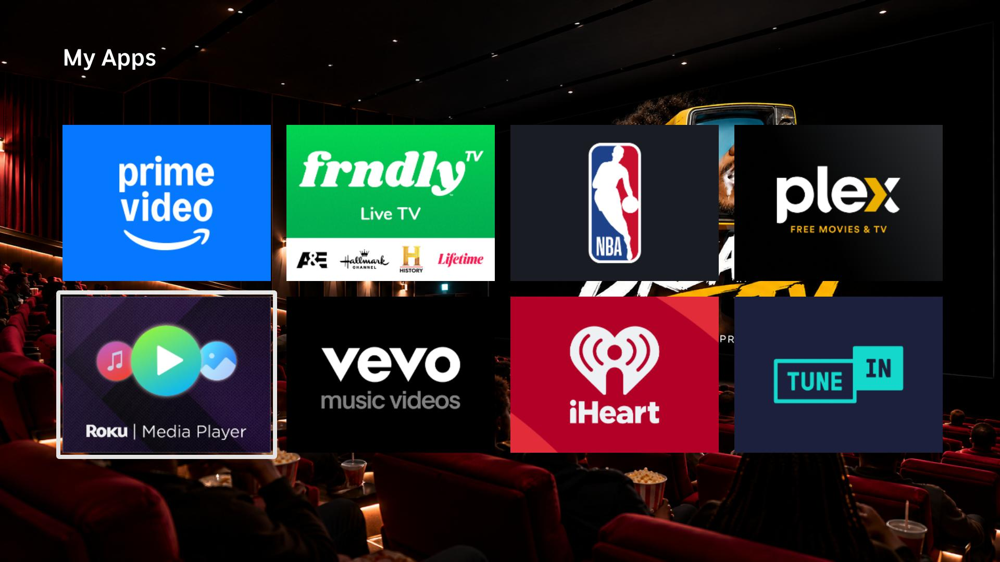
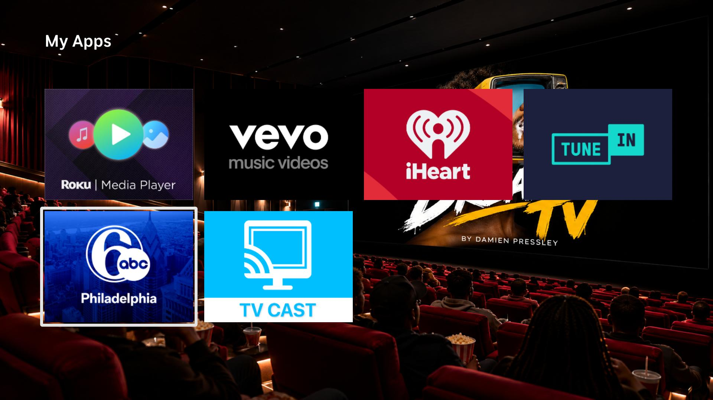
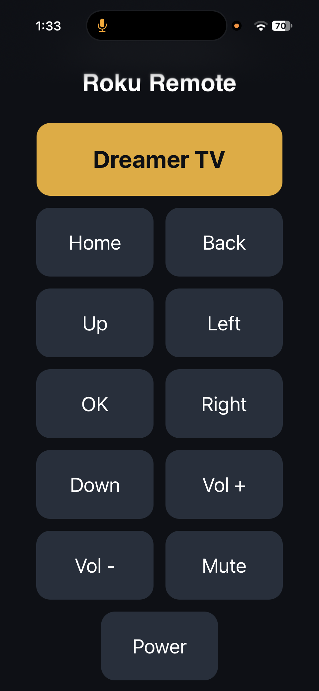

# CleanYourRoku

**Debloat your Roku TV over Wi-Fi and get an Apple TV-style home.**

Recommender systems decide a lot of what we watch. They pick the rows, the order, and the "next" thing before we've had a chance to choose. This project is about taking some of that control back.

CleanYourRoku is a guide and toolkit for turning off the tracking your Roku ships with, then replacing the cluttered home screen with the **CleanYourRoku launcher**, a custom home screen that shows only your apps, in the order you pick.

The launcher also has **My Channel**, a personal tile for your own family album. It holds a family tree, photos, videos, recipes, music and links, all from one settings file. Your videos and music can stream from your own [Jellyfin](docs/jellyfin.md) server. The album in this repo is filled with made-up sample family content for you to replace.

It was built with AI as a partner, not a decision-maker. Claude helped write code and work through problems, but every choice about what goes on the screen was made by a person. That's the whole point. You'll see the same idea throughout: every section explains *why*, not just *how*, so you can decide for yourself what's worth changing.

Built by **Damien Pressley ([UX Dreamer](https://github.com/dlpressl))**, a Human Systems Engineering grad student at Arizona State University.

> Inspired by [Gathin23/cleanyourtv](https://github.com/Gathin23/cleanyourtv), which does this for Android and Google TVs. Roku wasn't covered, so this project fills that gap.

---

## Why this exists

**Tracking is on by default, and it's buried.** Out of the box, Roku collects data about what you watch and uses it for ads. Roku-built TVs can go further and recognize what's on screen from other inputs too. The switches to turn this off exist, but they're spread across several menus and most people never find them.

**Your own apps come last.** On the Roku home screen, the apps you installed sit below rows of recommendations like these:

- Top picks for you
- Your next watch
- Kids and Family
- TV Shows
- Live TV
- Continue Watching

To reach something you chose, you scroll past things that were chosen for you.

**The ad panel can't be turned off.** The large panel on the right side of the home screen is advertising space. No setting removes it.

Why it matters: the layout of a home screen is a decision about attention. When the default puts recommendations first, it shapes what we watch, often without us noticing. A home screen that starts with *your* apps puts that decision back with you.

---

## Before and after

| Stage | Screenshot | What changed |
| --- | --- | --- |
| **Roku home, before** |  | Stock home screen (phone photos). Recommendation rows first, your apps below, ad panel on the right. |
| **Roku, after settings cleanup** |  | Tracking turned off in Settings. Less personalized, but the ad panel is still there. Settings alone can only go so far. |
| **Launcher v0** |  | A plain text list of apps (recreated). Proof that a custom launcher could run on the TV at all. |
| **Launcher v1** |  | Seven apps with logos. The first version that felt like a real home screen. |
| **Launcher v2** |  | The full 17-app grid, plus a tile with the early Dreamer TV artwork. No rows, no ads, just apps. |

<details>
<summary>See the rest of the v2 grid</summary>

The v2 grid scrolls four tiles at a time. These are the remaining pages:





</details>

Early test builds were called **Dreamer TV**, which is why that name appears on the tile in these screenshots. The launcher is now simply CleanYourRoku. The current build lists 20 apps plus the My Album tile, and you choose your own.

Why show the whole arc: the early versions were rough, and that's on purpose. Building in small steps made it easy to check each change against the question "is this what I actually want to see?"

---

## What's inside

| Path | What it covers | Code needed? |
| --- | --- | --- |
| [docs/roku-privacy-settings.md](docs/roku-privacy-settings.md) | **Step 0.** Every privacy and tracking setting worth changing, and what each one does. | No |
| [docs/roku-setup.md](docs/roku-setup.md) | The full install guide, plus publishing as a private beta. | A little |
| [docs/my-channel.md](docs/my-channel.md) | Making My Channel yours from one settings file. | A little |
| [docs/jellyfin.md](docs/jellyfin.md) | Streaming your own videos and music, with your API key kept out of Git. | A little |
| [docs/vizio.md](docs/vizio.md) | Notes for Vizio TVs. | No |
| [docs/ad-muter.md](docs/ad-muter.md) | The ad muter: what it does and how to run it. | Yes |
| [docs/faq.md](docs/faq.md) | Common questions and troubleshooting. | No |
| [docs/research.md](docs/research.md) | The research behind the project. | No |
| `manifest`, `source/`, `components/`, `images/`, `mychannel.json` | The launcher app (BrightScript). | Yes |
| [scripts/](scripts/) | Helper scripts (Python) that talk to the TV over your Wi-Fi network. | Yes |

---

## Install

### Step 0: Privacy settings (no code needed)

Start here even if you never install anything else. Changing a handful of settings on the Roku itself turns off most of the tracking and ad personalization. It takes about ten minutes and you can undo all of it.

Why first: it's the biggest privacy win for the least effort, and it doesn't require trusting any code from this repo.

Full walkthrough: [docs/roku-privacy-settings.md](docs/roku-privacy-settings.md)

### Step 1: Turn on developer mode

Roku has a built-in developer mode that lets you install your own app from a computer on the same Wi-Fi network. It doesn't go through the Roku Channel Store.

1. On your Roku remote press: **Home ×3, Up ×2, Right, Left, Right, Left, Right**.
2. Write down the IP address on screen. These steps call it `<ROKU_IP>`.
3. Select **Enable installer and restart**, then accept the agreement.
4. Set a password, and keep it out of anything you share.

Why sideloading: it's the only way to put a custom home screen on a Roku without modifying the TV's firmware. Nothing is hacked or permanently changed. You can remove it from the install page.

### Step 2: Get the code

```bash
git clone https://github.com/dlpressl/CleanYourRoku.git
cd CleanYourRoku
```

### Step 3: Choose your apps and pull their logos

List the apps installed on your Roku:

```bash
python3 scripts/pull_logos.py --roku <ROKU_IP> --list
```

Put the ones you want, in the order you want, in `m.apps` near the top of `components/HomeScene.xml`. Each entry is `["Name to show", "Roku app ID"]`. Then pull their logos:

```bash
python3 scripts/pull_logos.py --roku <ROKU_IP>
```

Why pull them yourself: app logos are other companies' trademarks, so they aren't in this repo. `pull_logos.py` asks your own Roku for the icons of the apps you listed and saves them to `images/` on your computer. `.gitignore` keeps them out of Git. Until you run it, app tiles stay blank, and any listed app that isn't installed on your Roku gets skipped.

If you get a 403 error, see the [FAQ](docs/faq.md#i-get-a-403-error).

### Step 4: Zip

From the repo folder:

```bash
zip -r cleanyourroku.zip manifest source components mychannel.json images \
  -x "*.DS_Store" "images/roku-*" "images/dreamer-tv-*" "images/phone-remote.png"
```

Why this command: it packs only the app, with `manifest` at the top level of the zip, where the Roku needs it. Don't right-click and compress the whole folder. The install will fail.

Using Jellyfin? Build with [these steps](docs/jellyfin.md#3-build-with-your-real-values) instead.

### Step 5: Delete, Upload, Install

1. On your computer, go to `http://<ROKU_IP>` and log in with username `rokudev` and the password you set.
2. **Delete:** if an app is already installed, delete it first.
3. **Upload:** choose `cleanyourroku.zip`.
4. **Install:** click Install. The launcher opens on your TV.

Repeat Steps 4 and 5 whenever you change something. Why delete first: Roku allows one sideloaded app at a time, and replacing it in place doesn't always pick up every change.

More detail: [docs/roku-setup.md](docs/roku-setup.md)

---

## Jellyfin setup

The sample videos and music in My Album stream from a [Jellyfin](https://jellyfin.org) server, so they won't play until you set up your own or replace them. The launcher works fine without it.

The short version:

1. Install Jellyfin on a computer at home and add your videos and music.
2. Create an API key in Jellyfin's admin dashboard.
3. Add your items to `mychannel.json`, and leave `YOUR_JELLYFIN_IP` and `YOUR_JELLYFIN_API_KEY` exactly as they are.
4. Put your real values in environment variables and build with the [Jellyfin build steps](docs/jellyfin.md#3-build-with-your-real-values).

**Keep your API key out of Git.** Never type the real key or IP into `mychannel.json`, because that file is tracked. The build steps fill them into a copy in `build/`, which is git-ignored, so the real values only exist on your computer and your Roku. The finished zip holds your key, so don't share it.

Full guide: [docs/jellyfin.md](docs/jellyfin.md)

---

## Honest limits

Better to know these up front:

- **Tested on two devices.** The Roku steps and the launcher have only been tested on Damien's own Roku streaming player (a box plugged into a TV). The Vizio guide was tested on his Vizio TV. Roku-built TVs and other Roku models may behave differently. If you try it on another device, please share how it went.
- **One sideloaded app at a time.** Installing a new zip replaces the old one.
- **Back goes to Roku's home.** When you press Back from inside an app, you land on Roku's home screen, not the launcher. Roku controls that behavior and a sideloaded channel can't override it.
- **It curates, it doesn't control.** The launcher changes what you *see*. It doesn't uninstall apps, block them, or lock anything down. It's not a parental control tool.
- **Some sample QR codes need work from you.** Links QR codes stay blank until you run `make_qr.py`, and the Family profile QR codes aren't included. See [docs/my-channel.md](docs/my-channel.md#step-by-step).

Why list these: a tool about agency should be honest about what it can and can't do, so you can make an informed choice.

---

## Built with

- **[Claude](https://claude.ai)** and **[Claude Code](https://claude.com/claude-code)**: coding partner for the launcher, scripts, and docs
- **Python**: helper scripts that talk to the TV over the network
- **BrightScript**: Roku's language, used for the CleanYourRoku launcher
- **Midjourney** and **ChatGPT image generation**: artwork and tiles
- **Figma**: designing the home screen layout
- **Jellyfin**: streaming your own videos and music
- **Terminal**: where it all comes together

### Phone remote (work in progress)



[`scripts/rokuremote.py`](scripts/rokuremote.py) runs a small web page from your computer that you open on your phone. It's a remote with big buttons and a one-tap **CleanYourRoku** button at the top. (The screenshot shows the button's earlier label, Dreamer TV.)

**Right now only the CleanYourRoku button works.** The other buttons are still being fixed. That one button is the useful part anyway: Roku sends you to its own home when you press Back from an app, and this gets you back to the launcher in one tap.

To try it, run `ROKU_IP=<ROKU_IP> python3 scripts/rokuremote.py` and open `http://<YOUR_COMPUTER_IP>:8001` on your phone.

<br clear="right">

---

## Research

This project grew out of coursework on recommender systems and human agency. It's the smart TV case study in my HSE 524 paper.

- **"From Audience to Main Character"** (HSE 524, link coming soon)

More background in [docs/research.md](docs/research.md).

---

## Contributing

Contributions are welcome, especially:

- Results from other Roku devices, including Roku-built TVs, and from other Vizio models
- Privacy settings that are missing or have moved in newer Roku OS versions
- Fixes and clearer explanations in the docs

Open an issue or a pull request. If you're adding a step, please include the *why* along with the *how*.

---

## Credits

- [Gathin23/cleanyourtv](https://github.com/Gathin23/cleanyourtv), the original inspiration for Android and Google TVs
- Built by Damien Pressley (UX Dreamer), with Claude as a partner

---

## License

[MIT](LICENSE) © 2026 Damien Pressley

*Unofficial. Not affiliated with, endorsed by, or sponsored by Roku, Inc. or Vizio, Inc.*
