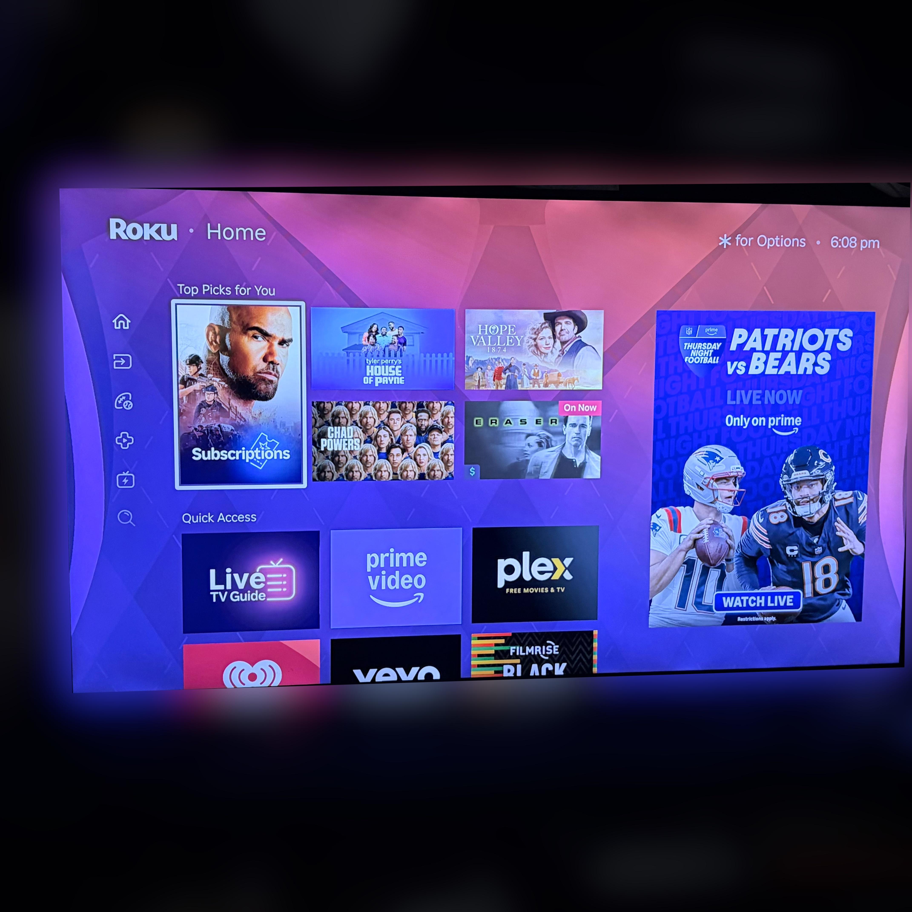
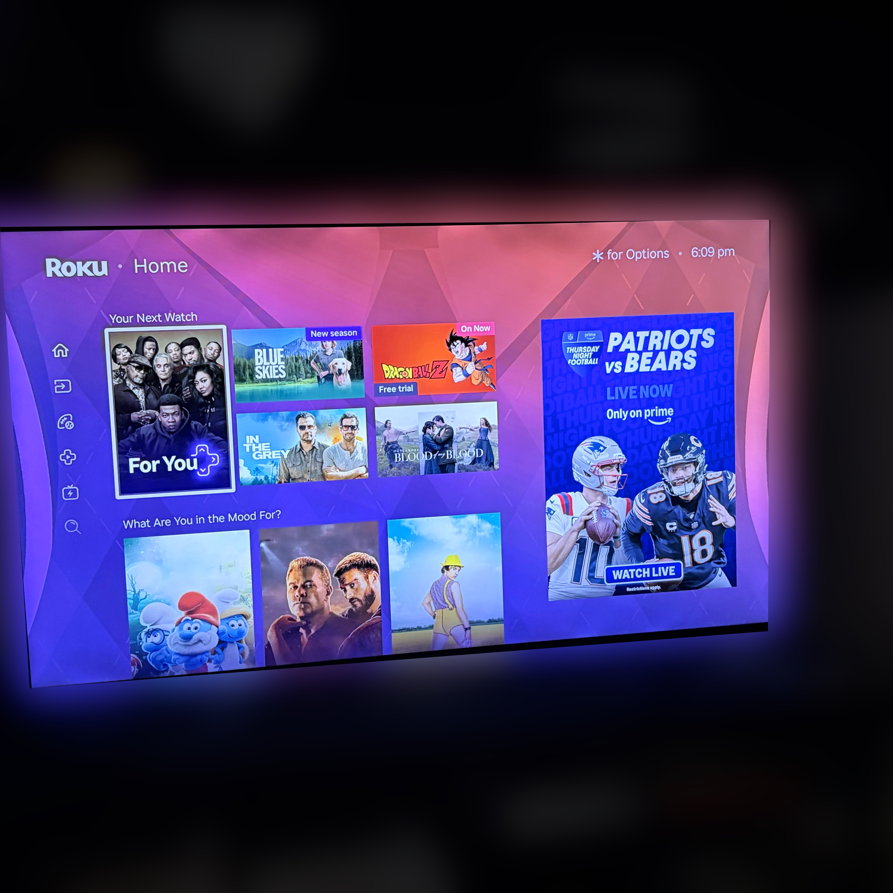
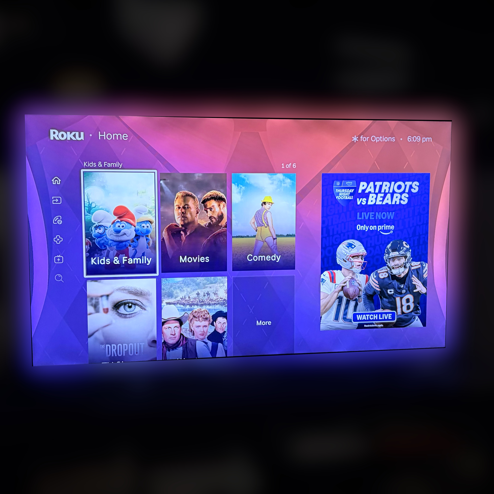
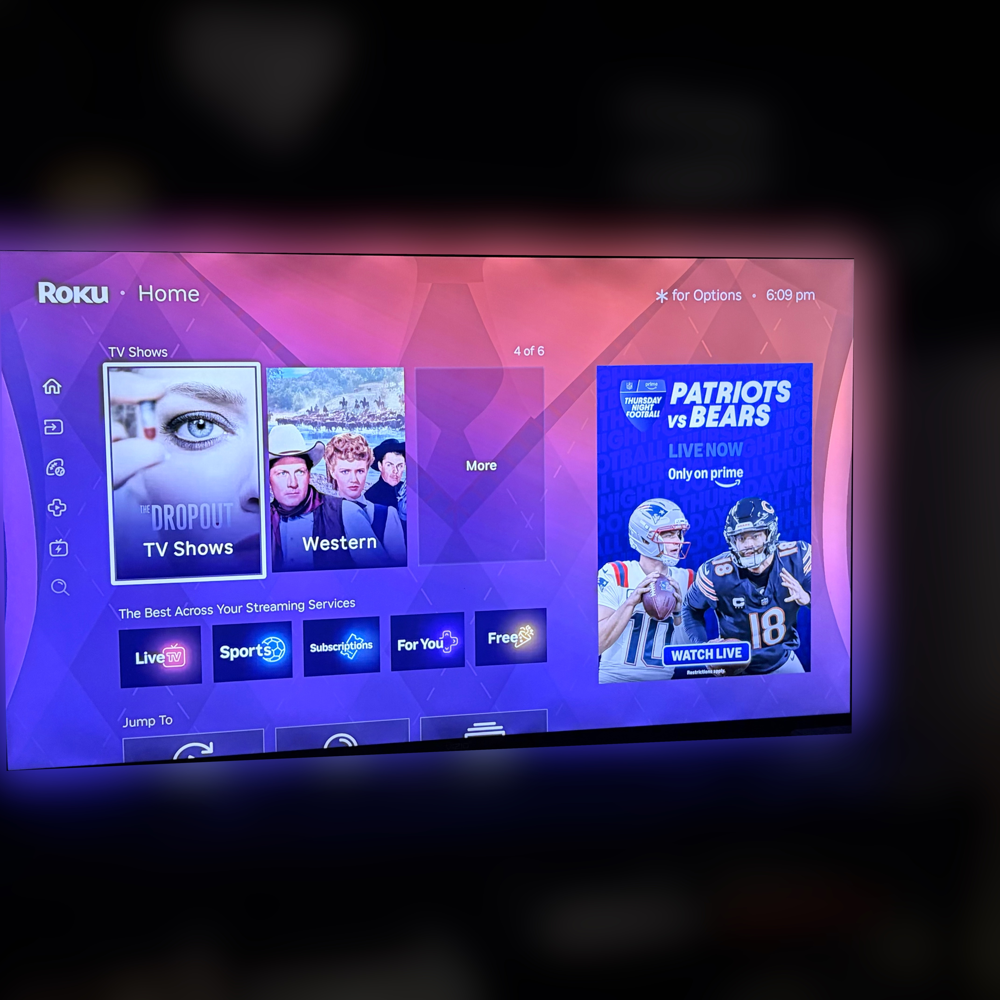
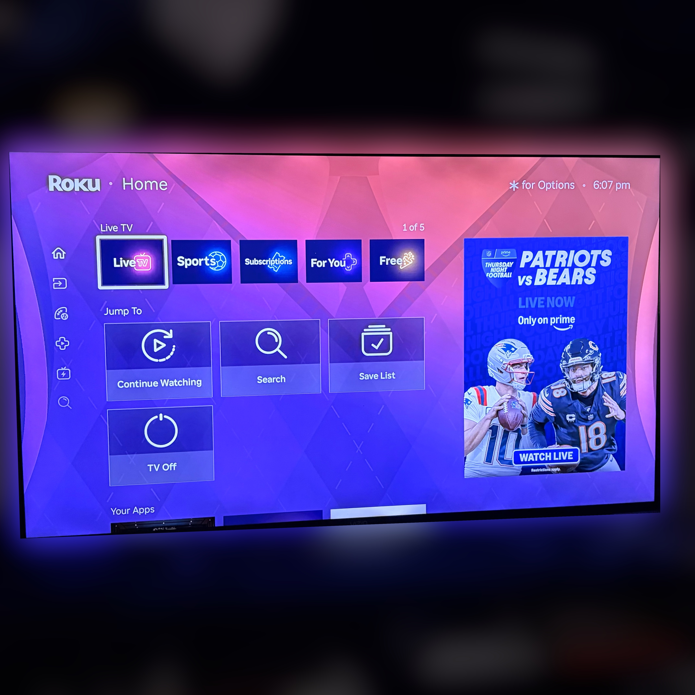
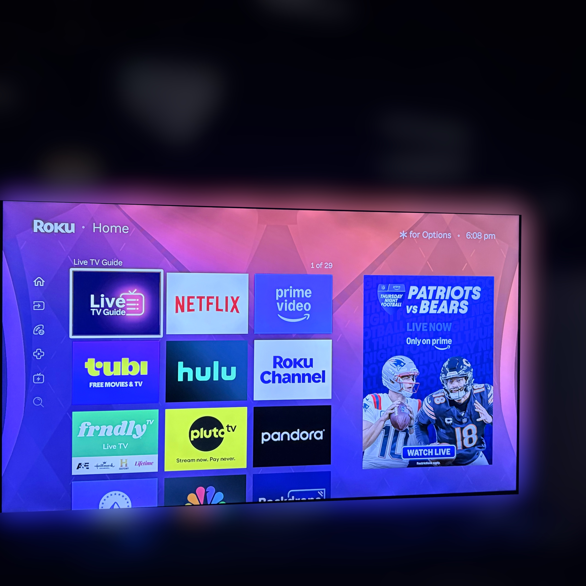
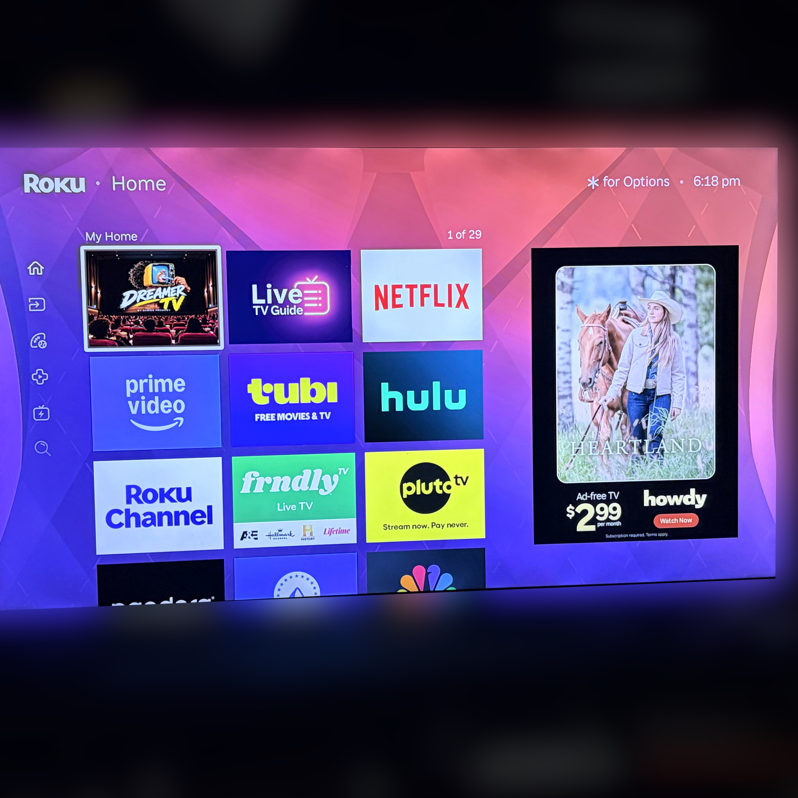

# Step 0: Roku privacy settings

**No code needed.** About ten minutes with your Roku remote. Every change here can be undone.

Start here even if you never install anything else from this repo. These settings are already on your Roku. They're just off by default or buried several menus deep. This guide explains what each one does and **why** it's worth changing, so you can decide for yourself.

> **Menu names vary.** Roku redesigned its home screen in 2026, and labels differ between software versions and devices. If a name below doesn't match exactly, look for the closest option in the same menu. These steps were tested on a Roku streaming player.

---

## The problem: your apps come last

Here's what Roku's home screen looks like out of the box. The first thing you see is **Top Picks for You**, chosen by Roku, plus an ad on the right.

Scroll down and the recommendation rows keep coming:

| Row | What it shows |
| --- | --- |
|  | **Your Next Watch** and **What Are You in the Mood For?** More picks based on what you've watched. |
|  | **Kids & Family**, **Movies**, **Comedy**: genre rows Roku curates for you. |
|  | **TV Shows**, then **The Best Across Your Streaming Services**. |
|  | **Live TV**, then **Jump To** with Continue Watching. The **Your Apps** label is just starting to peek in at the bottom. |
|  | Finally, **your apps**: the ones you actually chose to install. |

That's about **seven recommendation rows** between you and your own apps, and the ad panel on the right follows you the whole way down.

**Why this matters:** the order of a home screen is a decision about your attention. Putting recommendations first means Roku's choices get seen before yours, every time you turn on the TV. That's a filter bubble built into the layout.

---

## 1. Home screen: hide the recommendation rows

**Path:** Home → **Settings** → **Home Screen**

1. Find the option for **recommendations** on your Home Screen and set it to **Hide**.
2. Find **Quick Access** and set it to **Hide**.
3. Optional: try a different **tile size** if you want bigger app icons.

**Why:** this is the biggest visible change. Your own apps move to the top instead of sitting under rows Roku picked. Hiding Quick Access removes another row of shortcuts that Roku arranges, which isn't necessarily the order you'd choose.

If a stray suggestion still shows up, you can usually highlight it, press the ✱ (Options) button, and hide or rate it.

---

## 2. Privacy → Advertising: turn off personalized ads

**Path:** Home → **Settings** → **Privacy** → **Advertising**

1. Turn off **personalized ads**. Depending on your software version, this may be labeled **Personalize ads** (uncheck it) or **Limit ad tracking** (check it).
2. Select **Reset advertising identifier**.

**Why turn off personalized ads:** with it on, Roku uses what you watch to target the ads you see. Turning it off tells Roku and the apps on your device to stop using your viewing history for ad targeting.

To be clear about what it *doesn't* do: **you'll see the same number of ads.** They just won't be based on your viewing history. Apps can also choose to ignore this setting, so treat it as a strong request, not a guarantee.

**Why reset the advertising ID:** your advertising ID is the label advertisers use to connect what you've done into one profile. Resetting it gives you a new label, so the history tied to the old one stops following you. It doesn't stop data collection going forward, which is why you do it *after* turning off personalized ads.

---

## 3. Privacy → Smart TV experience: turn off ACR (Roku-built TVs only)

**Path:** Home → **Settings** → **Privacy** → **Smart TV experience**

1. Turn off **Use info from TV inputs**.

**You'll only see this on a Roku-built TV** (a TV with Roku built in, like many TCL, Hisense and Roku-brand TVs). If you use a Roku streaming stick or box plugged into another TV, as I do, this option won't be there and you can skip this step.

**Why:** this feature uses **automatic content recognition (ACR)**. The TV samples what's on screen, *including from your other inputs*, like a cable box, game console or antenna, and identifies what you're watching. That data can be used for recommendations and ad measurement. Most people never knowingly agreed to that. Turning it off means what you watch through other devices stays your business.

> **If you have another smart TV too:** many TVs from other brands have their own ACR setting. Vizio, for example, calls it "Viewing Data." It's worth checking. See [vizio.md](vizio.md).

---

## After: what changed, and what didn't

Here's the same Roku after these settings. The recommendation rows are gone from the top, and Roku's **My Home** row, with my own apps, now comes first.

But look at the right side.

**The ad panel is still there.** There's no setting that removes it. You can turn tracking off, hide the rows and reset your ad ID, and Roku will still reserve a big part of your home screen for advertising.

---

## The key insight

**You can turn off the tracking, but you can't turn off the ad panel.**

Settings get you part of the way. They're worth doing, and they're the part anyone can do without code. But the home screen itself still belongs to Roku, and Roku decides what goes on it.

That's why I built the **CleanYourRoku launcher**: a custom home screen that shows only your apps, in the order you choose, with no rows and no ad panel. It doesn't remove the ad panel from Roku's own home screen. Nothing can. It gives you a different home screen to open instead.

**Next step:** [Set up the launcher →](roku-setup.md)
